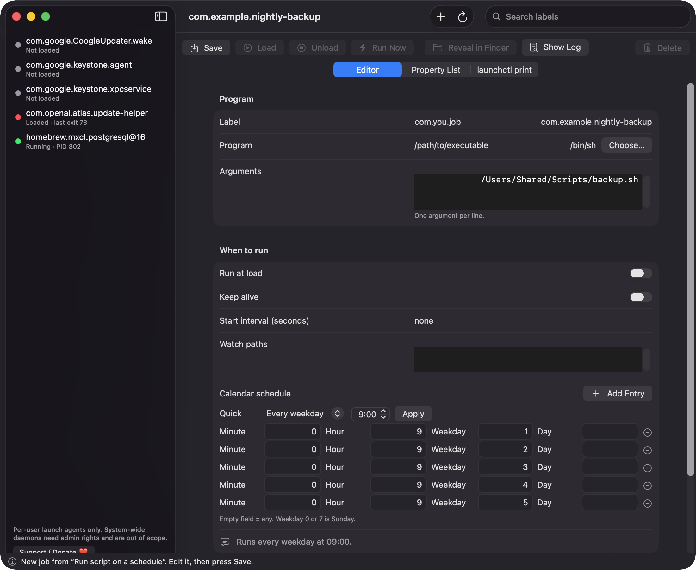
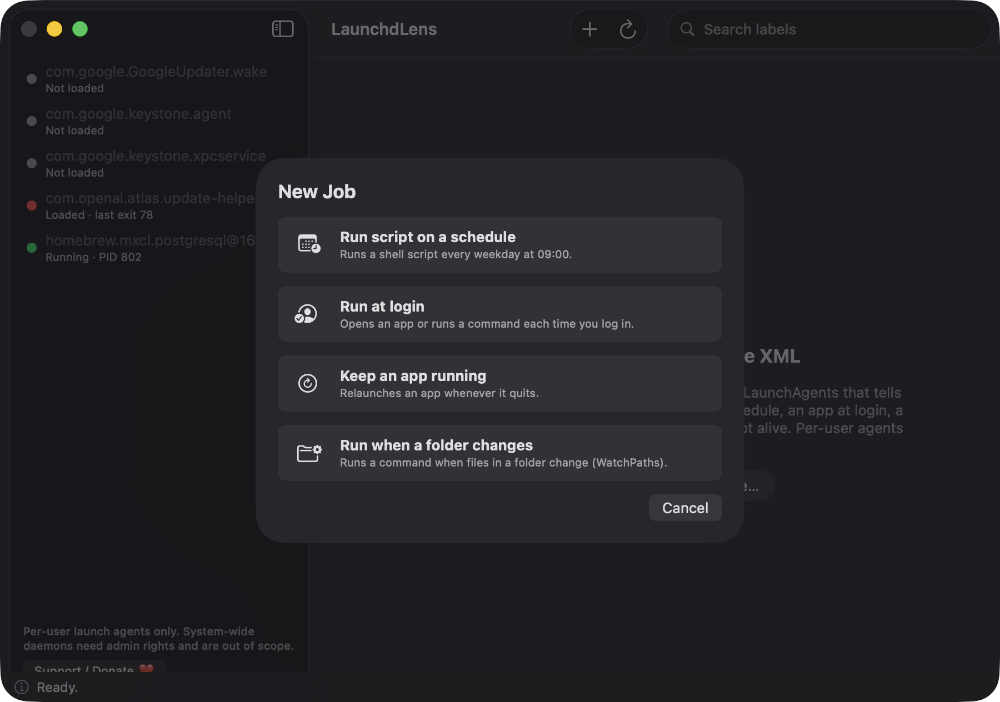
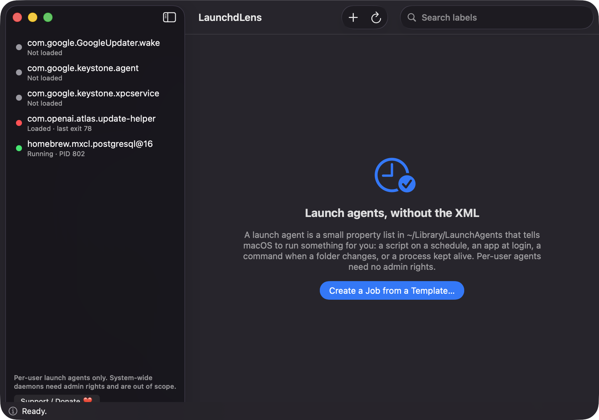
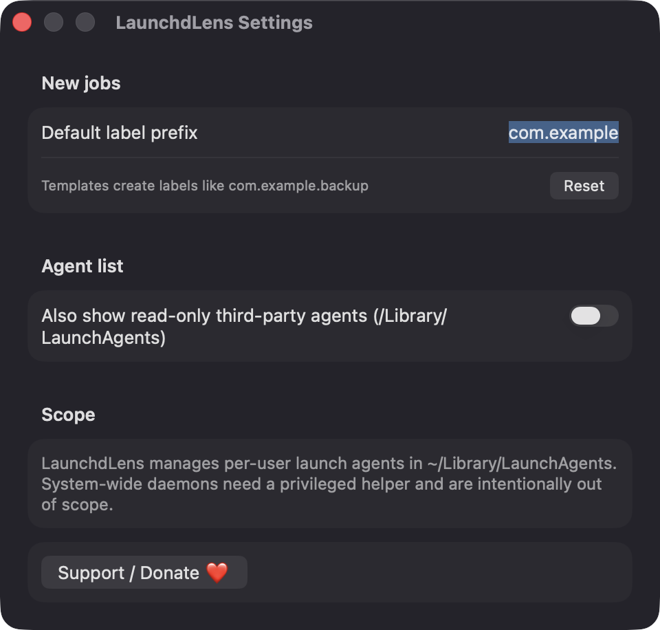

# LaunchdLens

**🌐 Website:** [turhe123.github.io/launchd-lens](https://turhe123.github.io/launchd-lens/)

Browse, create and schedule launchd jobs with a friendly editor instead of hand-writing property list files.


## Why

LaunchdLens is a free, open-source, 100% native, backend-free alternative to paid utilities in the *Developer & Network* category. It was inspired by Lingon X ($14.99 one-time), a well-regarded graphical editor for launchd. LaunchdLens covers a focused subset: per-user launch agents, with no accounts, no servers and no admin rights.

## Features

- **Agent browser**: a sidebar lists the `.plist` files in `~/Library/LaunchAgents`, with a searchable label filter.
- **Live status**: a colored dot per agent (green running with PID, blue loaded, red last run failed, gray not loaded) plus the last exit status. Status refreshes every 3 seconds from `launchctl list`.
- **Form editor**: Label, Program and arguments (one per line), Run at load, Keep alive, Start interval, Watch paths, Calendar schedule, Working directory, Standard output path and Standard error path.
- **Validation as you type**: red notes for a label that is not reverse-domain style, a program path that is missing, relative or not executable, a non-positive interval, or out-of-range calendar values. A file picker helps you choose the program.
- **Friendly schedules**: quick presets (every hour, day, weekday, week, month) expand into `StartCalendarInterval` entries, and a plain-language summary such as "Runs every weekday at 09:00." is shown back to you.
- **Templates**: Run script on a schedule, Run at login, Keep an app running, Run when a folder changes (`WatchPaths`).
- **Job actions**: Save, Load, Unload, Run Now, Reveal in Finder, Show Log and Delete, using `launchctl bootstrap`, `bootout`, `kickstart` and `print` in your `gui/<uid>` domain.
- **Raw views**: a read-only Property List tab with the generated XML, and a `launchctl print` tab.
- **Log viewer**: tails the last 64 KB of the job's output file and refreshes every 2 seconds.
- **Safe on existing files**: unknown keys are preserved on round trip, files are written atomically, and you are warned before overwriting a file LaunchdLens did not create.
- **Safe deletes**: loaded jobs are unloaded first, and the file goes to the Trash.
- **External change detection**: if a file changes on disk while you edit, you can reload or keep your edits.
- **Optional third-party agents**: a setting shows read-only agents from `/Library/LaunchAgents`. They can be loaded, run and inspected, but not edited.
- **Settings**: default label prefix (defaults to `com.<your username>`).
- **Keyboard**: ⌘N new job, ⌘S save, ⌘R run now, ⇧⌘R reload list.

Scope: per-user launch agents only. System-wide daemons need a privileged helper and are intentionally out of scope.

## Screenshots

<p align="center"></p>

<p align="center"><em>The form editor building a nightly backup job, with quick schedule presets, calendar entries and a plain-language summary: &quot;Runs every weekday at 09:00.&quot;</em></p>

<p align="center"></p>

<p align="center"><em>Start a new job from a template: run a script on a schedule, run at login, keep an app running, or run when a folder changes.</em></p>

<p align="center"></p>

<p align="center"><em>The sidebar lists every agent in ~/Library/LaunchAgents with live status: running with PID, loaded, failed with last exit code, or not loaded.</em></p>

<p align="center"></p>

<p align="center"><em>Settings for the default label prefix and an optional read-only view of third-party agents in /Library/LaunchAgents.</em></p>

## Install

1. Download `LaunchdLens-macOS.zip` from the [latest release](https://github.com/turhe123/launchd-lens/releases/latest).
2. Unzip it and move `LaunchdLens.app` to `/Applications`.
3. Because the app is open source and not notarized, clear the quarantine flag:

   ```bash
   xattr -cr /Applications/LaunchdLens.app
   ```

4. Right-click the app and choose **Open** the first time.

Requires macOS 14.0 or later.

## Build from source

```bash
brew install xcodegen
xcodegen generate
xcodebuild -project LaunchdLens.xcodeproj -scheme LaunchdLens -configuration Release -derivedDataPath ./build build
```

The app is produced at `build/Build/Products/Release/LaunchdLens.app`.

## Permissions

LaunchdLens does not request Accessibility, Screen Recording, Microphone, Camera, Contacts or Location access, and the code contains no usage-description prompts. What it does touch:

- **Files**: it reads and writes `~/Library/LaunchAgents` (and reads `/Library/LaunchAgents` if you enable third-party agents). It reads the log file paths you configure, and moves deleted job files to the Trash. The program picker uses the standard macOS open panel.
- **`/bin/launchctl`**: it runs this tool as your own user to load, unload, start and inspect jobs.
- **Preferences**: the label prefix, the third-party toggle and a list of files it created are stored in the app's `UserDefaults`.
- **Network**: none.

Jobs you create run with your user's permissions. If a job's script needs access to protected folders or other privacy-controlled resources, macOS may ask about that at the time the job runs.

## Built with AI

LaunchdLens was written by [Claude Code](https://claude.com/claude-code) inside an automated pipeline, from a plain-English spec. No code, binaries or assets from any commercial app were used; it is a clean-room reimplementation of a feature set, not a copy.

What that means in practice:

- The full source is in this repo under the MIT license. Read it before you run it.
- No network calls, no analytics, no third-party dependencies. Only Apple frameworks.
- Ad-hoc signed and not notarized, which is why Gatekeeper warns on first launch.
- It has had less human review than a hand-written app. Bug reports and pull requests are welcome.

## Support ❤️

If LaunchdLens saves you time, you can help keep these projects going:

[☕ Support Or (Leo) Davidai ❤️ on Ko-fi](https://ko-fi.com/leodavidai)

There is also a **Support / Donate ❤️** button inside the app.

## License

MIT © Or Davidai Bachar
